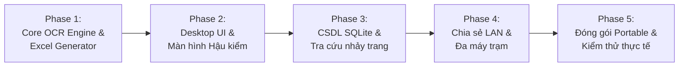

# KẾ HOẠCH TRIỂN KHAI DỰ ÁN (PROJECT PLAN)
## HỆ THỐNG SỐ HÓA, TỰ ĐỘNG ĐỔI TÊN & TRA CỨU HỒ SƠ GPLX

---

## 1. LỘ TRÌNH TỔNG QUAN (ROADMAP)

Dự án được chia làm **5 giai đoạn (Phases)** tuần tự nhằm đảm bảo chất lượng, kiểm soát rủi ro về độ chính xác OCR và bàn giao sản phẩm hoàn chỉnh, thân thiện nhất cho người dùng không rành IT.

---

## 2. CHI TIẾT CÁC GIAI ĐOẠN (DETAILED PHASES)

### Giai đoạn 1: Xây dựng Lõi Xử lý OCR & Tự động Sinh Excel (Phase 1: Core Engine) - ĐÃ HOÀN THÀNH ✅
- **Mục tiêu**: Chạy thử nghiệm thành công trên các file PDF scan thực tế, tách được bảng, đọc được bìa và xuất ra file Excel chuẩn + tên file đề xuất + File Excel Tổng hợp cấp Tỉnh.
- **Các nhiệm vụ cụ thể**:
  - [x] Phân tích cấu trúc trang bìa và trang danh sách từ tài liệu mẫu thực tế.
  - [x] Xây dựng module trích xuất ảnh độ nét cao từ PDF (sử dụng `pypdfium2` & `Pillow` ở 200–300 DPI siêu nhanh).
  - [x] Phát hiện vùng bảng biểu và phân nhóm dòng/cột bằng Bounding Box Clustering (STT, Họ tên, Năm sinh, Địa chỉ, Số bằng).
  - [x] Tích hợp mô hình OCR chữ in tiếng Việt & số (RapidOCR ONNX CPU runtime) tối ưu cho máy tính văn phòng.
  - [x] Viết bộ lọc chuẩn hóa Regex: Tự động sửa lỗi nhầm lẫn ký tự số bằng (O/0, I/1, S/5, ...).
  - [x] Xây dựng module tự động sinh file `.xlsx` con bằng `openpyxl` với định dạng chuẩn form nhà nước.
  - [x] Lập trình logic đặt tên file: Ghép `[Mã tỉnh].[SQL].[Tháng].[Năm].[SốĐầu]-[SốCuối]`.
  - [x] **[MỚI BỔ SUNG] Module phân tích đường dẫn thư mục 3 cấp** (`src/folder_parser.py`): Tự động bóc tách thông tin HỘP (Tủ hồ sơ) và HỘP SỐ (Hộp giấy) từ cấu trúc `Tỉnh / Hộp / Hộp số / file.pdf`.
  - [x] **[MỚI BỔ SUNG] Thuật toán rà soát dãy số GPLX** (`src/sequence_analyzer.py`): Tự động gom các số liên tiếp thành dải `A-B`, tách các dải ngắt quãng bằng dấu `; `, đánh giá tính liên tục ("Đủ" vs "Ngắt, không theo thứ tự").
  - [x] **[MỚI BỔ SUNG] Module tạo & cập nhật File Excel Tổng Hợp Tỉnh** (`src/master_summary.py`): Tự động duy trì và cập nhật file `"SỔ THEO DÕI, RÀ SOÁT DÃY SỐ GPLX TRONG SỔ GỐC"` theo tỉnh với đầy đủ 12 cột chuẩn.
  - [x] **[MỚI BỔ SUNG] Module phục hồi & chuẩn hóa Dấu Tiếng Việt** (`src/vietnamese_utils.py`):
    - [x] Tự động khôi phục dấu tiếng Việt chuẩn xác cho cột Họ và Tên (Họ: `Trần`, `Nguyễn`, `Hoàng`, `Đỗ`; Đệm: `Văn`, `Thị`, `Tiến`, `Vi`; Tên: `Yên`, `Thúy`, `Vinh`, `Thượng`...).
    - [x] Chuẩn hóa địa chỉ hành chính có dấu đầy đủ (`H. Lục Yên, Tỉnh Yên Bái`).
    - [x] Chuẩn hóa Quốc tịch (`Việt Nam`), Loại sổ (`Sổ gốc cấp bằng lái xe cơ giới đường bộ`).
    - [x] Lưu trữ đồng bộ Tiếng Việt có dấu vào file Excel con, File Tổng hợp tỉnh và CSDL SQLite (đồng thời lưu trường không dấu để tìm kiếm siêu tốc).
  - [x] **[MỚI BỔ SUNG] Chuẩn hóa số thứ tự (STT) lần lượt trong file Excel** (`src/table_extractor.py`, `src/pipeline.py`, `src/excel_generator.py`):
    - [x] Khắc phục triệt để lỗi STT bị lặp đếm lại từ 1..n theo từng trang riêng rẽ.
    - [x] Đảm bảo STT render ra file Excel đồng hành luôn chạy liên tục, tuần tự lần lượt từ 1 đến N xuyên suốt toàn bộ các trang của hồ sơ.
    - [x] Hỗ trợ hiển thị và cho phép chỉnh sửa STT trực tiếp trên giao diện Màn hình Hậu kiểm (`ReviewPanel`).
  - [x] Viết script kiểm thử đầu cuối `test_phase1.py` xử lý hoàn chỉnh tài liệu PDF scan mẫu và kiểm chứng file tổng hợp.
- **Sản phẩm đầu ra (Deliverables)**:
  - Script Python chạy kiểm thử độc lập: Nhận đầu vào là file PDF scan thô theo cấu trúc thư mục -> tự động nhận dạng bìa, đọc bảng, sinh file Excel con, đổi tên file PDF và cập nhật file Excel tổng hợp của tỉnh.

---

### Giai đoạn 2: Xây dựng Giao diện Desktop & Màn hình Hậu kiểm (Phase 2: Desktop UI & Review) - ĐÃ HOÀN THÀNH ✅
- **Mục tiêu**: Cung cấp giao diện trực quan cho nhân viên số hóa thực hiện nạp thư mục, kiểm tra nhanh và xác nhận đổi tên hàng loạt.
- **Các nhiệm vụ cụ thể**:
  - [x] Khởi tạo ứng dụng Desktop hoàn chỉnh bằng `CustomTkinter` (`src/gui/app.py` và `app_desktop.py`).
  - [x] **[MỚI] Mặc định mở toàn màn hình (Maximized Full Screen)**: Chiếm trọn màn hình máy tính ngay khi khởi chạy.
  - [x] **[MỚI] Giao diện Kéo giãn Đa năng (Resizable PanedWindow)**: Cho phép kéo sang trái/phải để tùy biến kích thước của 3 thành phần: Hàng đợi, PDF Preview và Xác nhận thông tin.
  - [x] **[MỚI] Cuộn ngang độc lập cho Trình xem PDF**: Tích hợp thanh cuộn ngang, cuộn dọc và hỗ trợ `Shift + Lăn chuột` duyệt ảnh scan khổ ngang mượt mà.
  - [x] **[MỚI] Hiệu ứng Icon Loading vòng tròn**: Hiển thị biểu tượng quay vòng tròn động trên nút OCR trong suốt thời gian tiến trình xử lý.
  - [x] **[MỚI] Cơ chế khóa / làm mờ (disable) nút bấm thông minh**:
    - [x] Nút *'Chạy OCR Tự Động'* tự làm mờ khi chưa upload file, tự bật sáng khi đã có file trong hàng đợi.
    - [x] Nút *'Xác nhận: Đổi tên PDF & Xuất Excel...'* tự làm mờ khi chưa chạy OCR xong, chỉ bật sáng khi dữ liệu đã sẵn sàng để đối soát.
  - [x] **[MỚI] Đổi màu nổi bật nút 'Chọn File PDF lẻ'**: Sử dụng màu xanh ngọc lục bảo (`#10B981`) bắt mắt, trực quan.
  - [x] **[MỚI] Lưu In-Place & Bảo toàn 100% file gốc**:
    - [x] Lưu file PDF chuẩn mới và file Excel con trực tiếp vào đúng thư mục tải lên (`os.path.dirname(original_path)`).
    - [x] Tuyệt đối không xóa hay sửa đổi file PDF scan gốc ban đầu.
    - [x] Tự động cập nhật file Excel Tổng hợp Tỉnh tại thư mục gốc Tỉnh (`find_province_root_dir`).
  - [x] Xây dựng màn hình **Hàng đợi Xử lý (Batch Queue)** (`src/gui/batch_queue.py`): Chọn thư mục, nạp cây thư mục Tỉnh/Hộp/Hộp số, hiển thị huy hiệu trạng thái (Chờ, Đang OCR, Chờ duyệt, Hoàn thành), thanh tiến độ và bộ chọn Tỉnh.
  - [x] Xây dựng màn hình **Đối soát Side-by-Side (Review & Edit)**:
    - [x] Nửa bên trái (`src/gui/pdf_viewer.py`): Khung xem trước file PDF độ nét cao, zoom in/out, xoay trang, nhảy trang.
    - [x] Nửa bên phải (`src/gui/review_panel.py`): Banner tên file đề xuất, form thông tin bìa (Loại sổ, Khóa, Ngày thi), **ô HỘP, HỘP SỐ**, **ô Rà soát dãy số & Ghi chú nhận định (Đủ vs Ngắt quãng)**, bảng dữ liệu công dân dạng ô nhập chỉnh sửa nhanh.
  - [x] Cơ chế tương tác nhảy trang: Bấm vào số trang `P.2` của công dân nào là PDF Viewer tự động cuộn đến chính xác trang đó.
  - [x] Nút bấm `1-Click Xác nhận`: Đổi tên file PDF + Tạo file Excel con + Cập nhật tự động dòng mới vào File Excel Tổng Hợp Tỉnh + Tự động chuyển trạng thái hàng đợi sang `Hoàn thành` và nạp file kế tiếp.
  - [x] **[MỚI] Nút 'Đổi tên file (theo folder)' với Thuật toán Fast OCR Siêu Tốc** (`src/gui/batch_queue.py`, `src/pipeline.py`):
    - [x] Cho phép chọn cả thư mục chứa hàng loạt file PDF scan gốc.
    - [x] **Thuật toán Fast OCR tối ưu hóa**: Chỉ đọc tối đa 3 trang (Trang 1: Bìa lấy Mã tỉnh/Tháng/Năm, Trang 2: Hàng 1 lấy Số bằng đầu, Trang cuối: Hàng cuối lấy Số bằng cuối). Bỏ qua 100% các trang ở giữa, giúp tăng tốc độ gấp 15 - 30 lần.
    - [x] Cơ chế cứu nguy tự động: Nếu ô đầu/cuối bị mờ/trống thì tự động quét dòng kế cận gần nhất để đảm bảo luôn trích xuất được số bằng chuẩn.
    - [x] Tự động copy ra file PDF mới có tên chuẩn `[Mã tỉnh].[SQL].[Tháng].[Năm].[Số đầu]-[Số cuối].pdf`.
    - [x] Bảo toàn 100% file gốc cũ, không xóa file cũ, không cần sinh file Excel con, có thanh tiến trình (progress bar).
  - [x] Viết script kiểm thử tự động `test_phase2.py` kiểm chứng toàn bộ luồng tương tác giao diện và cập nhật dữ liệu.
- **Sản phẩm đầu ra (Deliverables)**:
  - Ứng dụng Desktop chạy độc lập qua lệnh `python app_desktop.py`, giao diện trực quan, chia 3 cột hiện đại, mở toàn màn hình, lưu in-place an toàn và xử lý đa luồng ngầm không đơ giật.

---

### Giai đoạn 3: CSDL SQLite Zero-Config & Tra cứu Nhảy Trang (Phase 3: Database & Search) - ĐÃ HOÀN THÀNH ✅
- **Mục tiêu**: Xây dựng kho tra cứu tức thì cho cán bộ tiếp dân, gõ tên/số bằng là tìm thấy ngay và mở đúng trang PDF.
- **Các nhiệm vụ cụ thể**:
  - [x] Khởi tạo CSDL SQLite với bảng ảo `FTS5` (Full-Text Search) hỗ trợ tiếng Việt có dấu và không dấu (`src/database.py`).
  - [x] Xây dựng bộ đồng bộ (Sync Pipeline): Khi một file PDF được xác nhận đổi tên ở Phase 2, tự động chèn dữ liệu toàn bộ công dân vào SQLite.
  - [x] Xây dựng màn hình **Tra cứu Hồ sơ (Search Screen)** (`src/gui/search_screen.py`):
    - [x] Ô tìm kiếm thông minh: Gõ số bằng, họ tên (không dấu/có dấu), năm sinh.
    - [x] Bảng hiển thị danh sách kết quả tìm kiếm với độ trễ < 20ms.
    - [x] Bộ lọc theo Tỉnh / Thành phố.
    - [x] **[MỚI] Chế độ xem theo dõi '📁 Danh Mục Sổ / File Excel Đã Import'**:
      - [x] Bổ sung bộ chuyển đổi 2 chế độ xem: `👤 Tra Cứu Công Dân` và `📁 Danh Mục Sổ / File Excel Đã Import`.
      - [x] Bảng theo dõi chi tiết toàn bộ hồ sơ trong database: Tỉnh, HỘP, HỘP SỐ, Tên file PDF/Excel, Hạng, Khóa, Ngày bìa, Tổng số lượng GPLX, Ngày nạp.
      - [x] Thẻ thống kê tổng quan: Tổng số Tỉnh, Tổng số Hộp, Tổng số Hộp số, Tổng số file đã import.
      - [x] Nút tương tác nhanh: `👥 Xem toàn bộ công dân trong sổ`, `👁️ Mở PDF`, `📊 Mở Excel`.
  - [x] Tích hợp **Trình xem PDF nội bộ & Nhảy chính xác tới trang**:
    - [x] Bấm nút `👁️ Xem PDF (Trang X)` là hệ thống tự động lật đến chính xác trang của công dân đó.
  - [x] Thêm các nút thao tác nhanh:
    - [x] `📊 Mở Excel`: Mở trực tiếp file Excel con bằng Microsoft Excel.
    - [x] `📂 Thư mục`: Mở trực tiếp thư mục chứa file trong Windows File Explorer (`explorer.exe /select`).
  - [x] Xây dựng tính năng `🔄 Quét lại dữ liệu từ Excel (Re-indexing)` để đồng bộ nếu người dùng sửa file Excel bằng tay ngoài hệ thống.
  - [x] Tích hợp thanh điều hướng 2 Tab trên ứng dụng chính (`src/gui/app.py`): Tab 1: *Số Hóa & Đổi Tên*, Tab 2: *Tra Cứu Hồ Sơ*.
  - [x] Viết script kiểm thử tự động `test_phase3.py` kiểm chứng 100% chức năng CSDL, truy vấn đa năng và liên kết tệp.
- **Sản phẩm đầu ra (Deliverables)**:
  - Phân hệ tra cứu hoàn chỉnh, tìm kiếm đa tiêu chí siêu tốc, xem PDF nhảy trang trực tiếp, mở Excel và thư mục với 1 cú click.

---

### Giai đoạn 4: Tính năng Chia sẻ Mạng LAN Đa Máy (Phase 4: Multi-PC LAN Server) - ĐÃ HOÀN THÀNH ✅
- **Mục tiêu**: Cho phép nhiều máy tính trong cùng phòng làm việc cùng tra cứu dữ liệu từ một ổ SSD cắm ở máy chính.
- **Các nhiệm vụ cụ thể**:
  - [x] Cấu hình Backend FastAPI hỗ trợ lắng nghe trên toàn bộ giao diện mạng nội bộ (`0.0.0.0:8080`) (`src/server/lan_server.py`).
  - [x] Xây dựng giao diện Web Client hiện đại, thuần CSS/JS chạy 100% offline không cần internet (`src/server/static/index.html`):
    - [x] Ô tìm kiếm tự động lọc debounce theo Họ tên, Số bằng, Năm sinh.
    - [x] Bộ lọc theo Tỉnh / Thành phố.
    - [x] Bảng hiển thị kết quả trực quan, có badge số bằng nổi bật.
    - [x] Trình xem PDF nhúng (Modal Viewer) hỗ trợ nhảy thẳng đến trang của công dân (`#page=X`).
    - [x] Nút tải file Excel đồng hành về máy phụ.
  - [x] Xây dựng màn hình quản trị LAN trên giao diện Desktop (`src/gui/lan_screen.py` & Tab 3 trong `src/gui/app.py`):
    - [x] Nút bấm lớn `Bật / Tắt chia sẻ mạng LAN`.
    - [x] Tự động hiển thị IP máy chính (LAN IP: `192.168.x.x`), cổng (Port 8080) và đường dẫn truy cập đầy đủ.
    - [x] Nút `📋 Sao chép địa chỉ Web` và `🌐 Mở trên Trình duyệt`.
    - [x] Mã QR Code tự động sinh (`qrcode`) hiển thị trực tiếp trên giao diện để kết nối tức thì qua điện thoại / tablet.
    - [x] Bảng thống kê dữ liệu trực tiếp: Tổng số cuốn sổ, số công dân, trạng thái CSDL.
  - [x] Tự động lấy IP máy chính trong mạng LAN thông qua socket interface (`get_lan_ip()`).
  - [x] Cơ chế stream file PDF và tải file Excel qua mạng LAN an toàn (`/api/pdf`, `/api/excel`) với MIME headers chuẩn và hỗ trợ range requests.
  - [x] Viết script kiểm thử tự động `test_phase4.py` kiểm chứng 100% server, web client, các API và sinh mã QR.
- **Sản phẩm đầu ra (Deliverables)**:
  - Máy chính cắm ổ SSD mở app bật chia sẻ LAN; các máy phụ trong cùng văn phòng chỉ cần mở Chrome / Edge gõ IP hoặc quét mã QR là tra cứu và xem PDF bình thường không cần cài đặt.

---

### Giai đoạn 5: Đóng gói Portable, Tối ưu & Bàn giao (Phase 5: Packaging & Handover)
- **Mục tiêu**: Đóng gói thành bản Portable duy nhất nằm gọn trên ổ SSD, cắm vào máy tính là chạy; hướng dẫn sử dụng chi tiết.
- **Các nhiệm vụ cụ thể**:
  - [ ] Đóng gói toàn bộ mã nguồn, model AI, môi trường Python thành một thư mục Portable (dùng PyInstaller / Inno Setup).
  - [ ] Tối ưu hóa dung lượng model AI và tốc độ chạy trên CPU máy văn phòng (RAM 8GB, không GPU).
  - [ ] Thử nghiệm Stress Test: Quét và xử lý liên tục 50 - 100 cuốn sổ PDF (tương đương 500 - 1.000 trang).
  - [ ] Viết tài liệu hướng dẫn sử dụng nhanh dạng hình ảnh (Quick User Guide).
  - [ ] Bàn giao và nghiệm thu.

---

## 3. MA TRẬN RỦI RO & PHƯƠNG ÁN XỬ LÝ (RISK MATRIX)

| Rủi ro | Mức độ | Phương án xử lý |
| :--- | :---: | :--- |
| **Chữ viết tay số bằng quá mờ hoặc nét viết dị dạng** | Trung bình | - Hệ thống áp dụng quy tắc Regex bắt buộc định dạng chuẩn. - Đánh dấu màu vàng cảnh báo để người dùng kiểm tra nhanh trong 2 giây trên màn hình hậu kiểm trước khi xác nhận đổi tên. |
| **Người dùng vô tình sửa trực tiếp file Excel ngoài desktop làm lệch CSDL** | Thấp | Cung cấp nút `Quét & Đồng bộ lại từ Excel` trong màn hình Cài đặt, tự động cập nhật lại SQLite từ các file `.xlsx` trên ổ SSD. |
| **Mất điện hoặc tắt máy đột ngột khi đang xử lý** | Thấp | Cơ chế ghi file Atomic (đổi tên tạm sang file `.tmp`, thành công mới ghi đè tên chuẩn). File PDF gốc luôn được bảo vệ an toàn. |
| **Máy tính văn phòng cấu hình yếu (CPU Core i3/i5 cũ, RAM 4GB-8GB)** | Trung bình | Tối ưu mô hình OCR dạng Mobile/Lightweight (chỉ nặng ~15MB - 30MB), sử dụng ONNX Runtime đa luồng CPU, tốc độ xử lý chỉ 1.5s/trang. |
| **Xung đột tên file khi đổi tên** | Thấp | Tự động kiểm tra nếu trùng tên file đã có, hệ thống sẽ thêm hậu tố `_1`, `_2` hoặc thông báo cho nhân viên kiểm tra. |
