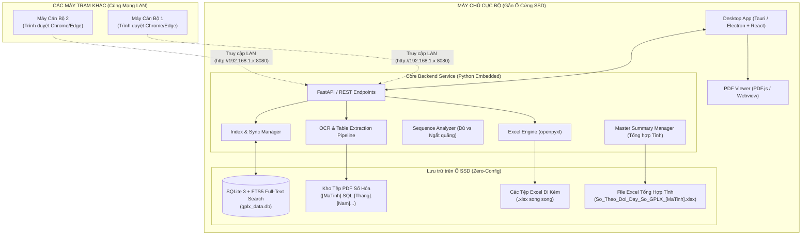
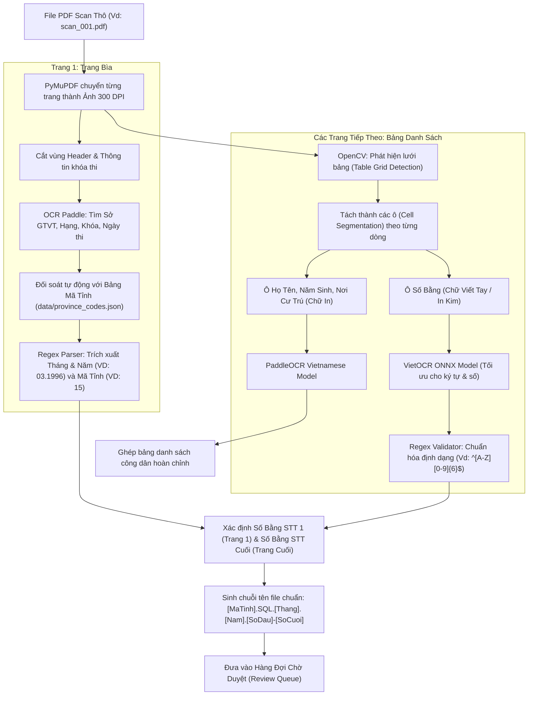

# TÀI LIỆU KIẾN TRÚC KỸ THUẬT (TECHNICAL ARCHITECTURE)
## HỆ THỐNG SỐ HÓA, TỰ ĐỘNG ĐỔI TÊN & TRA CỨU HỒ SƠ GPLX

---

## 1. TỔNG QUAN KIẾN TRÚC HỆ THỐNG (SYSTEM OVERVIEW)

Hệ thống được thiết kế theo mô hình **Hybrid Desktop & Local Service**:
- Vừa hoạt động như một ứng dụng Desktop Windows độc lập (Offline Standalone).
- Vừa có thể hoạt động như một **Local Web Server** thu nhỏ trong mạng nội bộ (LAN Server) chỉ với một nút bấm.
- Toàn bộ cơ chế lưu trữ là **Zero-Configuration** (Không cài đặt DBMS, không chạy Docker, không kết nối internet).



---

## 2. LỰA CHỌN CÔNG NGHỆ (TECH STACK & RATIONALE)

| Thành phần | Công nghệ đề xuất | Lý do lựa chọn |
| :--- | :--- | :--- |
| **Giao diện Desktop (UI Shell)** | **CustomTkinter + Tkinter PanedWindow** | Giao diện hiện đại, mượt mà, hỗ trợ **kéo giãn sang trái/phải để tùy biến kích thước 3 cột**, mở toàn màn hình, đóng gói file `.exe` tiện lợi. |
| **Trình xem PDF (PDF Viewer)** | **PDFViewerFrame (pypdfium2 + Canvas 2 Chiều)** | Tích hợp sâu vào UI, **hỗ trợ cuộn ngang (Horizontal scrollbar)** và cuộn dọc mượt mà (Shift + MouseWheel), điều khiển lật trang, xoay và zoom sắc nét. |
| **Xử lý nền (Backend Core)** | **Python 3.10+ (FastAPI + Uvicorn)** | Hệ sinh thái AI/OCR tiếng Việt số 1 hiện nay. Đóng gói gọn thành tiến trình nền (Portable Background Worker) bằng PyInstaller. |
| **Trích xuất & Xử lý PDF** | **PyMuPDF (`fitz`) & pdf2image** | Tốc độ chuyển đổi trang PDF sang ảnh siêu nhanh (vài chục ms/trang), giữ nguyên độ phân giải cao phục vụ OCR. |
| **Nhận diện Bảng & Xử lý ảnh** | **OpenCV + PP-StructureV2** | Tự động phát hiện các đường kẻ bảng (kể cả nét đứt), cắt thành từng ô (cell) độc lập để OCR chính xác từng cột. |
| **OCR Chữ In & Chữ Viết Tay** | **PaddleOCR v4 (Vietnamese) + VietOCR (ONNX)** | - PaddleOCR: Đọc chữ in tiếng Việt cực nhanh trên CPU (~0.2s/ô).<br>- VietOCR (chạy runtime ONNX nhẹ): Chuyên biệt hóa để đọc chữ viết tay và số bằng lái, tối ưu chạy mượt trên CPU máy văn phòng không cần card đồ họa rời. |
| **Xuất file Excel** | **openpyxl** | Tạo file `.xlsx` định dạng đẹp, căn giữa, kẻ bảng, tự động đặt tên theo chuẩn. |
| **Cơ sở dữ liệu (Database)** | **SQLite 3 + Module FTS5 (Full-Text Search)** | **Zero-Config 100%**: Chỉ là 1 file duy nhất `gplx_data.db` nằm trên ổ SSD. Không cần cài MySQL/SQL Server, hỗ trợ tìm kiếm không dấu siêu tốc (< 20ms). |

---

## 3. THIẾT KẾ CHI TIẾT PIPELINE OCR & TRÍCH XUẤT DỮ LIỆU



### 3.1. Chiến lược xử lý chữ viết tay và số bằng lái
- Cột **Số bằng** là yếu tố quan trọng nhất để tạo nên tên file:
  - Thông thường có dạng: 1 chữ cái + 6 chữ số (Ví dụ: `A161541`, `C244138`).
  - Đôi khi chữ `A`, `C` được viết tay ngoặc nét, số `1` dễ nhầm với chữ `l`/`I`, số `0` dễ nhầm với `O`.
- **Giải pháp xử lý:**
  1. *Rule-based Regex Correction*: Ký tự đầu tiên luôn được ánh xạ về tập chữ cái `[A-Z]`. Các ký tự tiếp theo luôn được ánh xạ về chữ số `[0-9]` (Ví dụ: nếu OCR ra `A16I541` thì tự động sửa thành `A161541`).
  2. *Đánh giá độ tin cậy (Confidence Score)*: Mỗi ô trích xuất trả về một điểm tin cậy từ 0.0 - 1.0. Nếu ô Số bằng có điểm < 0.85, hệ thống tự động gán cờ `Cần đối soát` để hiển thị nổi bật màu vàng trên màn hình duyệt.

---

## 4. THIẾT KẾ CƠ SỞ DỮ LIỆU ZERO-CONFIG (SQLITE + FTS5)

File CSDL được đặt trực tiếp trên ổ SSD tại đường dẫn: `X:\GPLX_DATA\database\gplx_index.db`.

### 4.1. Sơ đồ thực thể CSDL

```sql
-- Bảng 1: Quản lý các tập hồ sơ / Sổ quản lý (tương ứng từng file PDF)
CREATE TABLE IF NOT EXISTS dossiers (
    id INTEGER PRIMARY KEY AUTOINCREMENT,
    original_filename TEXT NOT NULL,         -- Tên file gốc ban đầu (VD: scan_001.pdf)
    final_filename TEXT NOT NULL UNIQUE,     -- Tên file chuẩn sau đổi (VD: 15.SQL.03.1996.A161541-C244140.pdf)
    excel_filename TEXT NOT NULL,            -- Tên file excel tương ứng
    file_path TEXT NOT NULL,                 -- Đường dẫn tương đối trên ổ SSD
    province_code TEXT NOT NULL,             -- Mã tỉnh (15)
    doc_type TEXT NOT NULL DEFAULT 'SQL',    -- Loại hồ sơ (SQL, QDTT,...)
    month_year TEXT NOT NULL,                -- Tháng năm (03.1996)
    first_license_no TEXT NOT NULL,          -- Số bằng đầu
    last_license_no TEXT NOT NULL,           -- Số bằng cuối
    total_citizens INTEGER DEFAULT 0,        -- Tổng số công dân trong sổ
    total_pages INTEGER DEFAULT 1,           -- Tổng số trang
    status TEXT DEFAULT 'COMPLETED',         -- PENDING, REVIEW, COMPLETED
    created_at DATETIME DEFAULT CURRENT_TIMESTAMP,
    updated_at DATETIME DEFAULT CURRENT_TIMESTAMP
);

-- Bảng 2: Danh sách chi tiết công dân trong từng sổ
CREATE TABLE IF NOT EXISTS citizens (
    id INTEGER PRIMARY KEY AUTOINCREMENT,
    dossier_id INTEGER NOT NULL,             -- Khóa ngoại trỏ về dossiers.id
    stt INTEGER NOT NULL,                    -- STT trong sổ (1, 2, 3...)
    full_name TEXT NOT NULL,                 -- Họ và tên (Trần Văn Yên)
    full_name_unaccented TEXT NOT NULL,      -- Họ tên không dấu để tìm kiếm siêu nhanh (tran van yen)
    birth_year TEXT,                         -- Năm sinh (1960)
    nationality TEXT DEFAULT 'Việt Nam',     -- Quốc tịch
    address TEXT,                            -- Nơi cư trú (H. Lục Yên tỉnh Yên Bái)
    license_number TEXT NOT NULL,            -- Số bằng lái (A161541)
    page_number INTEGER NOT NULL,            -- Nằm ở trang số mấy trong file PDF
    FOREIGN KEY(dossier_id) REFERENCES dossiers(id) ON DELETE CASCADE
);

-- Tạo chỉ mục tìm kiếm thông thường
CREATE INDEX IF NOT EXISTS idx_citizens_license ON citizens(license_number);
CREATE INDEX IF NOT EXISTS idx_citizens_name_unaccented ON citizens(full_name_unaccented);
CREATE INDEX IF NOT EXISTS idx_dossiers_final_filename ON dossiers(final_filename);

-- Bảng 3: Full-Text Search (FTS5) phục vụ tìm kiếm đa năng tức thì
CREATE VIRTUAL TABLE IF NOT EXISTS citizens_fts USING fts5(
    full_name,
    license_number,
    address,
    content='citizens',
    content_rowid='id'
);
```

### 4.2. Cơ chế Re-Index dự phòng (Chống lệch dữ liệu)
- Khi nhân viên sửa trực tiếp file `.xlsx` trên ổ SSD bằng Microsoft Excel ngoài ứng dụng, hệ thống cung cấp tính năng **Quét & Đồng bộ lại (Sync from Excel)**:
  - Duyệt qua toàn bộ thư mục `.xlsx` trên ổ SSD.
  - Tự động nạp lại bảng `citizens` để đảm bảo kết quả tìm kiếm luôn khớp 100% với file Excel.

---

## 5. MÔ HÌNH CHIA SẺ MẠNG NỘI BỘ (HYBRID LAN SERVER)

1. **Trên Máy Chủ (Máy cắm ổ SSD):**
   - Chạy ứng dụng Desktop.
   - Nhấn nút **"Bật chia sẻ mạng nội bộ"**:
     - Python FastAPI tự động bind vào IP LAN của máy (ví dụ: `0.0.0.0:8080`).
     - Giao diện Desktop hiển thị:
       - Trạng thái: `Đang chia sẻ` (Chấm xanh).
       - Địa chỉ truy cập: `http://192.168.1.15:8080`.
       - Nút `Sao chép đường dẫn` và `Hiện mã QR`.
2. **Trên Các Máy Trạm (Máy của nhân viên khác):**
   - Không cần cài bất cứ phần mềm nào.
   - Chỉ cần mở trình duyệt web (Google Chrome / Microsoft Edge / Cốc Cốc) và gõ `http://192.168.1.15:8080`.
   - Giao diện Web Client tải về nhẹ nhàng, cho phép:
     - Nhập số bằng / tên để tìm kiếm.
     - Xem danh sách kết quả.
     - Bấm xem trực tiếp file PDF (stream trực tiếp từ máy chủ).
     - Tải file Excel hoặc in ấn từ xa.

---

## 6. CẤU TRÚC THƯ MỤC TRÊN Ổ SSD DI ĐỘNG & QUY TRÌNH LƯU TRỮ IN-PLACE

Khi cắm ổ cứng SSD vào bất kỳ máy tính nào, cấu trúc dữ liệu luôn độc lập, bảo toàn 100% tệp gốc:

```text
D:\ (Ổ cứng SSD Di Động)
│
├── 📁 App_GPLX_Portable/            <-- Thư mục ứng dụng chạy ngay không cần cài đặt
│   ├── app_desktop.py / .exe       <-- File thực thi giao diện chính
│   ├── engine/                     <-- Bộ Python + OCR Model đóng gói sẵn
│   └── web/                        <-- Frontend giao diện web tĩnh phục vụ LAN
│
└── 📁 DuLieu_GPLX/                  <-- Kho dữ liệu hồ sơ phân cấp
    └── 📁 LaoCai/                  <-- Thư mục Cấp Tỉnh
        ├── So_Theo_Doi_Day_So_GPLX_15.xlsx  <-- File Excel Tổng Hợp Cấp Tỉnh (Tự động cập nhật)
        │
        └── 📁 HOP_48/              <-- Cấp Hộp (Tủ hồ sơ)
            └── 📁 HOP_SO_115/      <-- Cấp Hộp Số (Hộp giấy)
                ├── scan_001.pdf    <-- [BẢO TOÀN] File scan gốc giữ nguyên, KHÔNG BỊ XÓA
                ├── 15.SQL.03.1996.A461544-C244140.pdf   <-- [MỚI] Lưu trực tiếp in-place
                └── 15.SQL.03.1996.A461544-C244140.xlsx  <-- [MỚI] File Excel con cùng thư mục
```
