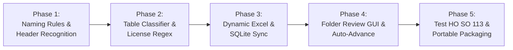

# KẾ HOẠCH TRIỂN KHAI PHIÊN BẢN 4 (PLAN VERSION 4)
## HỆ THỐNG SỐ HÓA, TỰ ĐỘNG ĐỔI TÊN & TRA CỨU HỒ SƠ GIẤY PHÉP LÁI XE (GPLX)

> **Căn cứ**: Kết quả phân tích và thống nhất toàn bộ các quyết định nghiệp vụ (Q1–Q8) trong buổi phỏng vấn `grill-me`.  
> **Mục tiêu**: Nâng cấp hệ thống nhận diện đa dạng mẫu tài liệu (bìa sổ, quyết định, quyết định kèm danh sách), tự động lọc đúng bảng GPLX bỏ qua bảng rác, sinh tên file chuẩn theo 3 nhóm thời gian, xuất Excel động đúng và đủ số cột nguồn, hoàn thiện luồng duyệt folder mượt mà tự động chuyển file và kiểm chứng 100% trên thư mục thực tế `C:\Users\FPT SHOP\Desktop\HOP 49\HOP 49\HO SO 113`.

---

## 1. QUY TẮC NGHIỆP VỤ ĐÃ THỐNG NHẤT (SPECIFICATIONS)

### 1.1. Quy tắc phân loại nhóm thời gian & Định dạng tên file PDF
Căn cứ vào **Ngày thi hoặc ngày sát hạch** để chọn nhóm thời gian. Dùng dấu chấm `.` phân tách toàn bộ các thành phần ngày tháng năm trong tên file (tuyệt đối không dùng dấu `/` để đảm bảo tương thích 100% trên Windows):

| Nhóm | Điều kiện ngày thi / sát hạch | Dữ liệu cấu thành tên file | Định dạng tên file chuẩn | Ví dụ thực tế |
| :---: | :--- | :--- | :--- | :--- |
| **SQL** | Đến hết `31/12/2012` | `Mã tỉnh` . `SQL` . `Tháng.Năm thi` . `Số đầu - Số cuối` | `[MãTỉnh].SQL.[MM].[YYYY].[SốĐầu]-[SốCuối].pdf` | `79.SQL.06.2008.AM570000-AM570200.pdf` |
| **QĐTT** | Từ `01/01/2013` đến `28/02/2025` | `Mã tỉnh` . `Phần số QĐ` . `Ngày.Tháng.Năm KÝ quyết định` | `[MãTỉnh].[SốQĐ].[DD].[MM].[YYYY].pdf` | `15.368.25.09.2015.pdf` |
| **QĐSH** | Từ `01/03/2025` trở đi | `Mã tỉnh` . `Phần số QĐ` . `Ngày.Tháng.Năm SÁT HẠCH` | `[MãTỉnh].[SốQĐ].[DD].[MM].[YYYY].pdf` | `15.3081.01.03.2025.pdf` |

- **Xử lý số quyết định**: Với `368/QĐ-SGTVT` -> phần đưa vào tên file là `368`. Thông tin hiển thị trên form và Sổ tổng hợp vẫn lưu đầy đủ chuỗi gốc `368/QĐ-SGTVT`.
- **Dấu phân cách**: Dấu chấm `.` giữa các trường; dấu gạch ngang `-` chỉ dùng duy nhất giữa số bằng đầu và số bằng cuối trong nhóm SQL.

### 1.2. Nhận diện trang đầu động & Phân biệt các loại tài liệu
Trang đầu của tài liệu scan có thể thuộc 3 dạng:
1. **Bìa cuốn sổ gốc (`cover`)**: Thường có các trường Hạng, Khóa, Ngày thi, Địa điểm thi (ảnh 1, ảnh 6).
2. **Quyết định công nhận trúng tuyển (`decision`)**: Có số quyết định (ví dụ `368/QĐ-SGTVT`), ngày ký quyết định ở góc trên phải, và ngày sát hạch trong phần căn cứ (ảnh 3, ảnh 4, ảnh 7).
3. **Quyết định kèm danh sách trên cùng trang đầu (`decision_with_list`)**: Có số quyết định, ngày tháng và bảng danh sách công dân bắt đầu ngay phía dưới (ảnh 8).

### 1.3. Thuật toán nhận diện & lọc đúng Bảng GPLX
- Trong file PDF có thể có nhiều bảng: Bảng kết quả tổng hợp thi lý thuyết/thực hành, bảng thu lệ phí sát hạch (ảnh 9) và bảng danh sách công dân cấp GPLX (ảnh 10, 12, 13).
- **Tiêu chuẩn nhận diện bảng GPLX**: Bắt buộc có cột Họ và tên VÀ một trong các cột (`Số bằng` / `Số GPLX` / `Số giấy phép` / `Mã GPLX` / `Năm sinh` / `Nơi cư trú` / `Ảnh` / `Ký nhận`).
- **Loại bỏ**: Bảng có các từ khóa `KHOÁ`, `TỔNG SỐ HỒ SƠ`, `LỆ PHÍ`, `THÀNH TIỀN`, `NỘI DUNG`.
- **Hỗ trợ bảng nhiều trang**: Tự động ghép nối các trang kế tiếp có cùng bố cục cột hoặc có tiêu đề lặp lại.
- **Nhiều danh sách độc lập**: Mặc định chọn danh sách đầu tiên/lớn nhất để lấy dải số bằng, có menu thả xuống trên giao diện cho phép chuyển đổi nếu cần.

### 1.4. Regex nhận diện Mã số GPLX & Xử lý cột trống
- Tên cột linh hoạt: `Số Bằng`, `Số GPLX`, `Số giấy phép`, `Mã GPLX` hoặc tiêu đề khác.
- **Mẫu Regex nhận diện mã số bằng**: `[A-Za-z]{1,2}\s*[0-9]{5,7}` (Ví dụ: `AP014542`, `AH515361`, `C244337`, `C244505`, `A465211`, `B295726`, `AM570000`).
- **Cột Số bằng trống (Verified Blank)**: Trường hợp có cột Số giấy phép nhưng để trống (như ảnh 12), đề xuất tên file theo mẫu: `15.SQL.[MM].[YYYY].A000000-A000000`.

### 1.5. Xuất Excel động (Dynamic Columns Companion Excel)
- Không fix cứng danh sách cột. Render bảng Excel con phản ánh đúng 100% số lượng, thứ tự và tiêu đề các cột của bảng gốc trong file PDF (như ảnh 12 có 13 cột, ảnh 13 có 6 cột).
- Giữ nguyên cột Ảnh và Ký nhận; nếu nhận diện được vùng ảnh thì nhúng ảnh crop vào ô, giữ các ô trống theo đúng tài liệu gốc.
- Bổ sung cột phụ `Trang PDF` ở cuối cùng để hỗ trợ click tra cứu nhảy trang trong CSDL SQLite.

### 1.6. Quy trình duyệt "Đổi tên file (theo folder)" trên giao diện
- **Panel Trái**: Hiển thị danh sách file PDF trong folder được chọn, kèm huy hiệu trạng thái (`CHỜ DUYỆT`, `ĐÃ HOÀN THÀNH`).
- **Panel Giữa**: Xem trước trực quan bản scan PDF (phóng to, thu nhỏ, xoay, cuộn ngang khổ A3).
- **Panel Phải**: Form tinh gọn "THÔNG TIN BÌA SỔ & VỊ TRÍ HỒ SƠ" (như ảnh 14): Loại sổ, Ngày bìa sổ/Ngày thi/Ngày ký, Hạng, Khóa, HỘP, HỘP SỐ, Tổng số GPLX, Nhận định (Đủ / Ngắt quãng), Dãy số GPLX.
- **Tự động cập nhật tên đề xuất**: Khi người dùng chỉnh sửa bất kỳ ô nào trên form, tên file đề xuất tự động cập nhật thời gian thực.
- **Xác nhận 1-Click**:
  - Tạo file PDF mới mang tên chuẩn tại đúng folder (bảo toàn 100% file gốc cũ).
  - Cập nhật 1 dòng vào `So_Theo_Doi_Day_So_GPLX_XX.xlsx` ở thư mục cấp tỉnh (không sinh dòng trùng nếu lưu lại).
  - Đánh dấu file là `HOÀN THÀNH` và **tự động chuyển sang file PDF tiếp theo** trong hàng đợi.

---

## 2. KẾ HOẠCH TRIỂN KHAI 5 GIAI ĐOẠN (5-PHASE ROADMAP)

### Phase 1 — Bộ quy tắc tên 3 nhóm & Nhận diện trang đầu động
- **Mục tiêu**: Hoàn thiện lõi nhận diện bìa sổ, quyết định, quyết định kèm danh sách; bóc tách số quyết định và phân định ngày ký vs ngày sát hạch; sinh tên chuẩn cho cả 3 nhóm SQL, QĐTT, QĐSH.
- **Files**: `src/naming_rules.py`, `src/cover_parser.py`.

### Phase 2 — Thuật toán nhận diện, phân loại Table GPLX & Regex mã số bằng
- **Mục tiêu**: Tự động lọc tìm đúng bảng danh sách cấp GPLX, loại bỏ bảng tổng hợp thống kê/lệ phí; nhận diện linh hoạt tên cột số bằng và mẫu mã số bằng `[A-Z]{1,2}[0-9]{6}`; xử lý trường hợp cột số bằng trống (`A000000-A000000`).
- **Files**: `src/table_extractor.py`, `src/sequence_analyzer.py`.

### Phase 3 — Xuất Excel động (Dynamic Columns) & Đồng bộ Tra cứu
- **Mục tiêu**: Xuất file Excel con với cấu trúc cột động đúng 100% tài liệu gốc; nhúng ảnh/chữ ký hoặc giữ ô trống theo nguyên bản; nâng cấp bộ đọc của `DatabaseManager` để đồng bộ tra cứu tức thì mọi mẫu Excel.
- **Files**: `src/excel_generator.py`, `src/database.py`.

### Phase 4 — Giao diện duyệt Folder 3 Panel & Tự động chuyển file kế tiếp
- **Mục tiêu**: Nâng cấp giao diện duyệt folder theo ảnh 14; Panel phải hiển thị form tinh gọn thông tin bìa/vị trí hồ sơ; tự động cập nhật tên đề xuất khi sửa form; khi bấm Xác nhận thì tạo PDF mới, cập nhật Sổ tổng hợp cấp tỉnh và tự động chuyển sang file tiếp theo.
- **Files**: `src/gui/batch_queue.py`, `src/gui/review_panel.py`, `src/gui/app.py`, `src/master_summary.py`, `src/pipeline.py`.

### Phase 5 — Kiểm thử thực tế trên `HO SO 113`, Đóng gói Portable & Nghiệm thu
- **Mục tiêu**: Xóa bỏ các file test cũ và `plan_version3.md`; xây dựng test suite mới `test_version4_full.py`; chạy thử nghiệm thực tế trên toàn bộ 5 file PDF tại `C:\Users\FPT SHOP\Desktop\HOP 49\HOP 49\HO SO 113`; đóng gói và xác nhận file `So Hoa GPLX.zip` cùng `Build_So_Hoa_GPLX.bat`.
- **Nghiệm thu**: 100% test pass, kiểm thử thành công trên `HO SO 113`, bàn giao hoàn tất.
